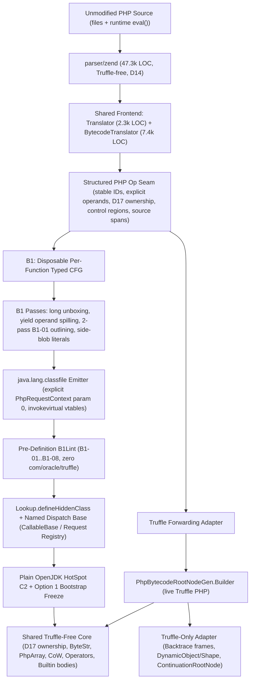

# Milestone B1 Plan: Dual-Backend `.php → .class` on HotSpot C2 + Option 1 (2026-11-26)

Part of the [wiki](README.md). Implements **[D19](decisions.md)** (amended 2026-11-26 after independent architectural
reviews by Fable 5.2 and Astra 6.2) on top of the passed pre-checks ([b1-precheck.md](b1-precheck.md),
[bootstrap-freeze.md](bootstrap-freeze.md), [b1-lint.md](b1-lint.md)).

---

## 1. Goal & Non-Negotiable Constraints

- **Primary target:** Compile unmodified PHP (starting with Gate 1 / `hot.php`, scaling to WordPress + WooCommerce) to
  JVM `.class` bytecode via JDK 25's `java.lang.classfile`, running on **plain OpenJDK HotSpot C2
  (`-XX:-UseJVMCICompiler`) + Option 1 Bootstrap Freeze**, with **zero Truffle classes loaded** at runtime.
- **Secondary target:** Keep **live Truffle PHP** working through the **exact same PHP frontend** (`parser/zend` +
  `Translator` + `BytecodeTranslator`), serving as both the secondary runtime and the semantic oracle alongside pinned
  PHP 8.5.13.
- **Zero semantic forks (no repeating D16):** PHP semantics (`D17` refcounting/destructors, CoW arrays, coercion,
  builtins) must live in **one** Truffle-free shared core, never maintained twice in Java and Python projection patches.
- **Vertical slice first:** Prove **real PHP-compiled `.class`** matches Probe B's hand-written `1.11×` C2 control and
  exact `D17` semantics *before* implementing all 276 `@Operation`s.

---

## 2. Dual-Backend Architecture

### Why a Disposable Per-Function CFG (Not 1:1 Streaming of the 607-Method DSL Builder)
1. `BytecodeTranslator` currently calls `607` generated Truffle Bytecode DSL builder methods (`271 begin*`,
   `271 end*`, `63 emit*`, `2 create*`) containing DSL-only mechanics: `BindStackValue`/`LoadStackValue` (callee
   resolution before by-ref argument evaluation), operands provided only at `end*` (`endStoreTemp(owned)`,
   `endReleaseAfter`), replayed `finally` `Runnable`s, `@ShortCircuitOperation` (`&&` bool-coercing vs `?:`
   value-preserving), and `@Yield` + `Resumed`.
2. B1 needs four whole-function analyses that single-pass streaming cannot do cleanly:
   - **Proven `long` local unboxing** (matching Probe B's zero-box hot loops while guarding overflow & PHP coercions).
   - **Generator suspension spilling** (saving live locals *and* enclosing expression operands + active cleanup regions).
   - **2-pass `B1-01` method outlining** (measuring exact emitted `Code` bytes and splitting safely around backward
     `goto` and multi-exit `finally`).
   - **Ordered binary-safe constant side blobs** loaded via `ConstantDynamic` from hidden-class `classData`.
3. Building the CFG **one function at a time and discarding it right after `.class` emission** keeps idle RAM at zero
   retained IR (avoiding Truffle's `~190 MB` retained source/AST/bytecode footprint).

---

## 3. Seam, Runtime & Compiler Invariants (The 6 Refinements)

### 3.1 Clean Frontend Seam (Stable IDs + `Translator.java` + In-Process `eval()`)
- Cover both [Translator.java](file:///C:/Users/krzgo/Projects/wordpress/src/main/java/pl/codeloom/php/parser/Translator.java)
  (classes, functions, closures, default-arg/constant thunks) and
  [BytecodeTranslator.java](file:///C:/Users/krzgo/Projects/wordpress/src/main/java/pl/codeloom/php/parser/BytecodeTranslator.java).
- Replace all live Truffle objects crossing the seam (`PropSite`, `CallInfo`, `PhpFunction`, `ClassTemplate`,
  `LocalAccessor`, `TruffleString`, `root.initialize*`, `BytecodeParser` traversal-order `made()` reuse) with
  **stable integer/descriptor IDs** and backend-owned caches.
- Support **in-process runtime compilation** on a Truffle-free classpath: `hot.php` (and WordPress/plugins) create
  functions, classes, and closures via runtime `eval()`, so the compiler cannot be offline-only.

### 3.2 Explicit `D17` Ownership on Normal & Exceptional Edges
- Represent ownership transfers and ordered cleanup explicitly in the structured ops and CFG:
  - Argument temporary transfers that still clean up if a *later* argument throws before the call starts.
  - `StoreTemp(owned)` / `ReleaseTemp` (including moved values) and `ReleaseAfter`.
  - Return-value protection while locals are released, plus exceptional unwind of active `foreach` iterators and `@`
    silence state.
  - **One logical PHP frame & one function epilog:** outlined helpers must never run PHP function-exit cleanup on
    helper return.

### 3.3 Runtime & Builtins: Hybrid (c) → Shared Core (b)
Codebase census (verified independently by both Fable 5.2 and Astra 6.2):
- Builtins: `342` of `617` `Registry.fn` registrations **already** accept an explicit context parameter; only `35`
  direct `PhpContext.get(null)` calls exist across 11 builtin files (`16` in `CurlFunctions`), and only `8` of `49`
  builtin files import Truffle beyond `@TruffleBoundary`/`TruffleString`.
- Runtime: `34` direct `PhpContext.get(null)` calls across 10 files; ~`40` direct `TruffleString *Uncached` calls
  outside `Str`.

**Migration order:**
1. **Mechanical projection only for Gate 1 speed:** Allow an explicit-allowlist projection script **strictly for
   mechanical swaps** (package/annotation/string type). **Zero semantic patches** in Python.
2. **High-leverage `src/main` cleanups first:**
   - Pass `PhpRequestContext` through `Registry.fn`'s invocation boundary (eliminates ambient lookup for all 342
     context-taking builtins at once).
   - Fold the ~40 direct `TruffleString *Uncached` calls outside `Str` into `Str`.
   - Upstream Probe B's verified `D17` fixes (`PhpRef.set` retain→publish→release, `gcArrayRoots` cleanup, exception
     chaining, `call1`/`call2`/`callSlice` parameter retention) into the shared core with PHP 8.5.13 differential tests.
   - Replace the remaining `35 + 34` `PhpContext.get(null)` sites incrementally as fixtures exercise them.
3. **Keep Truffle-only adapters out of the shared core:** Truffle frame walking (`Backtrace`), `DynamicObject`/`Shape`
   (`PhpObject`), and `ContinuationRootNode` stay in the Truffle adapter; B1 supplies explicit PHP logical frames and
   source spans for errors and backtraces (including across outlined helpers).

### 3.4 Generators & Fibers
- **Generators:** Explicit state machine + heap resumable frame:
  - Bind parameters at creation; suspend before first body statement.
  - Save resume PC, live locals **and enclosing expression operands**, active cleanup regions, and `yield from`
    delegation state.
  - Support `send`, injected `throw`, delegated return, and forced close at the exact suspension point; yielding
    preserves `D17` ownership and abandonment releases it.
  - Resume labels double as legal outlining entry points.
- **Fibers:** Keep the existing platform-thread handoff (`FiberThread` / `FiberGate`) with explicit `PhpRequestContext`
  (JDK 25 virtual threads pin/starve carriers when a native `libcurl` callback suspends).

### 3.5 CFG-Based `B1-01` Outlining
- Model branch destinations (including backward `goto`), protected `try`/`catch`/`finally` regions, pending exits
  (return/break/throw), and exceptional successors before partitioning.
- Prefer empty-operand-stack, single-entry cuts keeping whole loops and handlers intact; where an oversized region has
  no clean cut, emit a dispatcher + spill record carrying live values and pending exit state (including updates visible
  to handlers after a throw). Emit `finally` bodies once as helper methods rather than duplicating across exits.
- Two-pass sizing: measure actual emitted `Code` bytes and repartition any helper exceeding `7,500` bytes (`4,000` for
  `<clinit>`).
- Verification: test on a forced low-threshold split-vs-unsplit fixture (`goto` + `finally` + `D17`), plus real
  [large-function.php](file:///C:/Users/krzgo/Projects/wordpress/src/test/resources/compile/large-function.php) and
  WordPress's `WP_Query::get_posts`.

### 3.6 `B1Lint` & Hidden-Class Contract
- Upgrade [B1Lint.java](file:///C:/Users/krzgo/Projects/wordpress/bench/b1-precheck/probe-b/tools/B1Lint.java) from
  Probe B prototype to production compiler gate (see [b1-lint.md](b1-lint.md)):
  - Lint the exact emitted `byte[]` **in-memory before `defineHiddenClass`** (not just `.class` files on disk).
  - Replace hardcoded `MegaGenerated` / 6-method-name filters with explicit emitted-class / `@HotPath` tagging.
  - Add **`B1-08`:** forbid any constant-pool reference to `com/oracle/truffle/*` in B1 runtime and emitted classes, and
    verify zero Truffle class loads via `-Xlog:class+load` on a Truffle-free classpath.
  - Allow `ConstantDynamic` (for hidden-class `classData` side blobs) while keeping `invokedynamic` forbidden (`B1-02`).
- **Hidden-class linkage:** Because hidden classes cannot be named in another class's constant pool, all cross-file PHP
  calls go through a named runtime dispatch base (`CallableBase` vtable `invoke0`/`1`/`2`/`invoke` + request registry)
  — matching Probe B's already-proven `invokevirtual` design. Exercise actual `defineHiddenClass` reload + request drain
  + GC reclamation.

---

## 4. Week 1–2 Vertical-Slice Execution Plan

| Window | Deliverables | Verification & Exit Criteria |
|---|---|---|
| **Week 1, Days 1–2** | **Settle the shared structured-op seam** (`Translator` + `BytecodeTranslator` → stable-ID structured ops) + thin Truffle forwarding adapter + minimal B1 CFG skeleton. Compile **one tough PHP fixture** through *both* backends via normal file & function entry points. | Fixture includes: by-ref argument, a *later* argument that throws before the call starts, a `D17` `__destruct` observer, and a source-line backtrace assertion. Both Truffle and B1 match **pinned PHP 8.5.13** byte-for-byte on output, error line, and destructor order. Existing `mvn test` / Truffle smoke stays green. |
| **Week 1, Days 3–5** | **Real hidden-class emission on stock OpenJDK + first Gate 1 kernel + `eval()` + outlining proof.** Wire explicit `PhpRequestContext` param 0, Probe B's `CallableBase` `invoke0`/`1`/`2` + `callSlice`, unboxed `long` locals, `ConstantDynamic` side-blob literals, upgraded pre-definition `B1Lint` (`B1-01..B1-08`), and zero-Truffle classpath test. | Compile and run real PHP `hooks` / `aget` / `post` / `mega` kernels + an `eval()`-defined closure on plain OpenJDK (`-XX:-UseJVMCICompiler`) with `0` Truffle classes loaded and `0` `B1Lint` violations. Run a forced low-threshold outlining test on a `goto`/`finally`/`D17` fixture asserting **identical** output & destructor order between split and unsplit execution. |
| **Week 2, Days 1–3** | **Hard PHP semantics & WordPress stress fixtures.** Implement generator resumable frame (`yield` / `yield from` / `send` / `throw` / abandonment cleanup), wire platform-thread `Fiber` with explicit context, run `D17` `.phpt` destructor subset, and compile **`large-function.php` + real `WP_Query::get_posts`** with full `D17`. | `D17` `.phpt` subset & `d17_fixture.php` exact match vs PHP 8.5.13; `yield from` + native-callback fiber regressions pass; `large-function.php` & `WP_Query::get_posts` emit `0` methods `> 7,500` B (`B1-01`), install at C2 top tier, and pass `B1Lint`. Exercise hidden-class plugin reload (`0` surviving retired loaders) and 2-context freeze/restore isolation (array cursors, refs, static properties). |
| **Week 2, Days 4–5** | **Gate 1 benchmark on real PHP-compiled `.class`** across `K0–K7` and all 11 `hot.php` kernels in Linux Docker (`--cpuset-cpus 14-21`, ≥ 5 interleaved rounds, pinned PHP 8.5.13 JIT vs plain OpenJDK HotSpot C2 `-Xmx64m`, with Probe B Rev 4b as hand-written control). | **Go Criteria:** 100% checksum & `D17` parity; **≥ 1.10×** PHP 8.5.13 JIT geomean (no kernel `< 0.85×`; paired 2-context penalty `≤ 5%`; `≤ 2` steady-state uncommon traps); `0` methods `> 7,500` B; `apply_filters` + `WP_Hook::apply_filters` `≤ 60–100 KB` machine code; mixed-suite peak RSS `≤ 200 MiB`. Any miss is logged quantitatively against Probe B's `1.11×` control. |

### Immediate Post-B1 Gate (Weeks 3+)
- Expand remaining `@Operation`s & builtins in the shared core → **`K8` full WordPress front-page render** (`≤ 10–11.2 ms`,
  `≤ 400 MiB`) → **served 5-plugin WordPress + WooCommerce** with **Option 1 Freeze** (`get_option()` read-set
  invalidation + async snapshot rebuilds) at `16 / 25 / 30` concurrent clients against the best `php-fpm` pool meeting
  the same throughput and p99 latency.

---

## 5. Progress & Test State Log

| Milestone | Commit | Test & Verification State |
|---|---|---|
| **Week 1, Days 1–2** *(Dual-backend structured PHP IR seam + `TruffleIrAdapter` + Truffle-free B1 `.class` emitter + `B1Lint` `B1-01..B1-08`)* | `de97f19` | **DONE** (2 rounds of read-only adversarial audits passed): **90/90** Maven tests green on GraalVM 25.4.4.1.1 (**18/18** `CompilationTest`, **8/8** `ZendParserCorpusTest`); **24/24** PHP 8.5.13 differential fixtures byte-identical (`contract_d17.php` + 23 audit fixtures); **222/222** previously passing Truffle smoke tests green (`444/444` 1-ctx + 3-ctx shared comparisons, 0 regressions); **5,730 / 7,341** (`78.1%` strict, **5,841 / `79.6%`** lenient) php-src `.phpt` passing (`Zend/tests` `3,612/4,963`, `ext/standard` `1,681/1,891`, `ext/pcre` `133/145`, `ext/json` `67/78`, `tests/lang` `237/264`, **0** IR/adapter internal errors); standalone stock Temurin OpenJDK 25.0.4 (`-XX:-UseJVMCICompiler`, **0** Truffle JARs): **0** `B1Lint` violations, **0** Truffle classes loaded, **0** live destructibles, `166/166` B matching PHP 8.5.13. |
| **Week 1, Days 3–5** *(Real Gate 1 kernels `hooks`/`aget`/`post`/`eval_mega` + in-process `eval()` closure + `ConstantDynamic` side-blob literals + forced-threshold `goto`/`finally` outlining + `B1-09..B1-13`)* | `4348a61` | **DONE** (adversarial audit + all 19 P1 & 2 P2 fixes verified): **114/114** Maven tests green on GraalVM 25.4.4.1.1 (**18/18** `CompilationTest`, **8/8** `ZendParserCorpusTest`); stock Temurin OpenJDK 25.0.4 (`verify-b1-standalone.ps1`, **0** Truffle JARs, **0** Truffle loads, **0** `B1Lint` violations `B1-01..B1-13`, **0** live destructibles): byte-exact PHP 8.5.13 parity across `contract_d17`, `w1d35_aget`, `w1d35_hooks`, `w1d35_post`, `w1d35_eval_mega` (`56` `eval()` hidden classes), `w1d35_sideblob` (`ConstantDynamic` `classData`, 0 `<clinit>`), and `w1d35_outline` (7500 B unsplit & 220 B forced-split `46` helpers / max `218` B). |
| **Week 2, Part A (Days 1–2)** *(Real `d17_fixture.php` + Bacon-Rajan cycle GC + real `large-function.php` outlining + C2 Tier-4 steady-state + `B1Snapshot` 2-ctx isolation + hidden-class reload)* | `0544008` | **DONE** (Claude Opus adversarial audit + all 8 audit fix groups verified; closes issues `005`/`036` on B1): **133/133** Maven tests (**18/18** `CompilationTest`, **8/8** `ZendParserCorpusTest`); **222/222** smoke tests (`444/444` 1-ctx + 3-ctx); **49/49** stock Temurin 25.0.4 fixtures matching PHP 8.5.13 byte-for-byte (**0** Truffle loads, **0** `B1Lint` violations `B1-01..B1-13`); `d17_fixture.php` **556/556 B** (12k bookmarks `peak=1`, cycles `2`/`4`, resurrection, `G2→G1→G3→A1→A2`); `large-function.php` (`563` LOC / `7,920` AST nodes) outlined into **8 fragments** (`6,109–6,435` B, `run` `74` B), **all 9 retaining HotSpot C2 Tier 4 steady state**; 200k-cycle GC cut `1.954s → 1.236s` & `389.2 → 273.9 MiB`; 5 reloads **0/10** leaked hidden classes; 2-context `B1Snapshot` isolation verified. |
| **Week 2, Part B (Day 3)** *(Explicit resumable-frame Generators `yield`/`yield from`, platform-thread `Fiber` `B1-13`, real `WP_Query::get_posts` outlining check, `B1BatchMain` `.phpt` runner)* | `364d21d`, `6661be4` | **DONE** (Claude Opus + Gemini 4 Neon Round 2 adversarial audits passed): **139/139** Maven tests (**18/18** `CompilationTest`, **8/8** `ZendParserCorpusTest`, **6/6** `WeekTwoPartBTest`); stock Temurin OpenJDK 25.0.4 standalone (`33` runtime classes + `52` runs, **0** Truffle loads, **0** `B1-01..B1-13` violations): `w2b_generators` (`7500` B unsplit & `220` B forced-split `123` helpers / max `220` B, `476/476` B match), `w2b_fibers` (`292/292` B match + native FFM `qsort` upcall suspension & worker reuse/join), `WP_Query::get_posts` inventory + excerpt outlining (`<= 220` B), and **`B1BatchMain` `.phpt` on stock OpenJDK 25.0.4: `142/142` supported cases passing (`100.0%`, `0` diff / `0` error / `0` timeout)** across `Zend/tests/{gc: 3, exceptions: 19, generators: 80, fibers: 40}` (`261` unsupported). |
| **Week 2, Days 4–5** *(Gate 1 benchmark on real PHP-compiled `.class`: JDK 25 C2 vs JDK 28-ea C2 vs PHP 8.5.13 JIT + Passes 1–3 optimizations + JDK 28-ea virtual-thread native-pinning check)* | `fedc173`, `b483f7d`, `68fdcb2`, `8189166` | **DONE** (4 Neon cross-model adversarial audits passed; full report in [`bench/b1-week2/RESULTS.md`](../bench/b1-week2/RESULTS.md)): **178/178** Maven tests (`18/18` `CompilationTest`, `8/8` `ZendParserCorpusTest`), **48/48** standalone Temurin OpenJDK 25.0.4 matches + 5 expected fatals (**0** Truffle loads, **0** `B1-01..B1-13` violations across `38` runtime + `445` hidden classes, `max_code = 4,734 B`), and **142/142** Linux Docker `.phpt` (`0` diff). Official **5-round interleaved Linux Docker** (`--cpuset-cpus=14-21`, 100% checksum parity across all 17 kernels): 4-kernel geomean progressed **`0.08× → 0.39× → 0.48× → 0.54×` (JDK 25) / `0.56×` (JDK 28-ea)** vs Probe B `1.11×` control (`hooks` `0.48×`, `aget` `0.44×`, `post` `0.81×` p10 / `0.86×` med, `mega` `0.58×`); 17-kernel geomean `0.50× / 0.53×` with **`k0-floatloop` beating PHP 8.5.13 JIT (`1.05×` JDK 25 / `1.27×` JDK 28-ea)**, `k0-intloop` `0.98×`, `k0-mandelbrot` `0.87×`; **`0–1` steady-state uncommon traps**, **`46.2–58.1 KB`** combined `apply_filters` + `WP_Hook::apply_filters` C2 code, **`70.3–116.2 MiB`** peak cgroup RAM; paired 2ctx CtxA `+5.6%..+13.2%` & remaining `0.56× → ≥ 1.10×` gap logged quantitatively for **W3-5**. Empirical **JDK 25.0.5.1 vs JDK 28-ea+25** FFM `qsort` probe confirmed native upcalls **still pin and starve virtual-thread carriers on JDK 28-ea** (`jdk.VirtualThreadPinned` `60.4 ms` + deadlock), confirming **`B1-13` platform-thread Fibers remain required**. |

---

## 6. Post-Week-2 Plan (Weeks 3+): Remaining "Hard 20%" & 5 Force-Multiplier Refactors

*Architectural audit conducted at end of Week 2 (`8189166`, 2026-11-27) before scaling from ~15–20% B1 PHP coverage (`72` IR nodes, `~40` builtins) to full WordPress `K8` (`625k` LOC PHP, `~570` needed builtins) and served WooCommerce.*

### 6.1 Honest Audit: What Hard 20% Is Done vs. Still Ahead

**Solved & Neon-verified in Weeks 1–2 (JVM/C2 & core runtime traps):**
- Exact `D17` refcounting, intra-statement `__destruct()` timing, and `B1Thrown.chain` exception chaining (`d17_fixture.php` `556/556` B).
- Bacon-Rajan cycle GC (`B1CycleCollector`, O(1) root buffer) + Zend `rc == 1` reverse-globals shutdown.
- Resumable-frame Generators (`yield`/`yield from`/`send`/`throw`/force-close) and platform-thread Fibers (`B1-13`, empirically re-confirmed on JDK 28-ea+25 where FFM native upcalls still pin & starve virtual-thread carriers).
- 2-pass `B1-01` CFG outlining (`≤ 7,500 B`, C2 Tier 4 steady state on `large-function.php` and `WP_Query::get_posts`).
- Hidden-class linkage (`B1Callable` vtable, `B1CodeCache`, zero-leak reload reclamation, `B1Lint` `B1-01..B1-13`, `0` Truffle loads).
- Per-request `B1RequestContext` + `B1Snapshot` freeze/restore isolation (`0` `ThreadLocal`s, `0` steady-state traps).

**Remaining "Hard 20%" problems NOT yet designed in B1 (must be solved cleanly *before* bulk feature expansion):**
1. **Shared Builtin & Extension Core Drift (§3.3):** Weeks 1–2 grew a parallel `B1*` runtime with ~40 hand-written builtins inside a monolithic `B1RequestContext.Builtin` `switch`. WordPress core calls `677` distinct built-ins (`~570` needed) plus PCRE2, JSON, Date/Time, MBString, Streams/FS, Serialize, MariaDB/PDO, and cURL — almost all of which **already exist in Truffle PHP** (`41/49` builtin files import no Truffle beyond `@TruffleBoundary`/`TruffleString`). Rewriting them by hand in B1 would create a massive semantic fork and waste weeks.
2. **Full PHP OOP Object Model:** B1 `ClassDef`/`MethodSites` currently lack `extends` inheritance, `implements` interfaces, `traits`, `spl_autoload_register`, `parent::` / `static::` (late static binding), private-property owner mangling (`Owner\0prop`), subtype checks for `instanceof` and `catch (ParentException $e)`, and magic hooks (`__get`/`__set`/`__isset`/`__unset`/`__call`/`__callStatic`/`ArrayAccess`/`Iterator`/`Countable`). WordPress and WooCommerce rely on all of these.
3. **Emitter Codegen Duplication (`B1ClassFileEmitter` ~1,900 LOC):** Maintaining three parallel emission paths (`run` fast JVM-local, `runLeaf` zero-frame, `runFiber` slow frame) plus `B1GeneratorLowerer` means every new IR node is wired in 4 places — directly causing Pass 1 and Pass 3 P0 audit bugs (`B1GeneratorLowerer` missing new ops, `double` missing `deferredLeft` and closure captures).
4. **WordPress Request-Lifecycle Semantics:** Function/method-scoped `include`/`require` (e.g., `load_template()` extracting `$args` into local scope before `require`), `@` error suppression + `set_error_handler`, output buffering (`ob_start`/`ob_get_clean`), `$GLOBALS` aliasing, and PCRE2 FFM (`preg_replace_callback`).

### 6.2 Ordered Execution Plan for Weeks 3+ (Do the 5 Force Multipliers FIRST!)

Execute these 5 stages **in strict order** immediately after Week 2 Days 4–5 wraps up. Every implementation stage uses `claude-private --model opus` followed by mandatory read-only adversarial review with `agy` Neon (`gemini-4-neon-high`).

| Order | Stage | Concrete Deliverables | Why First / Speedup Payoff | Exit Criteria |
|---|---|---|---|---|
| **W3-1** | **Pareto Coverage Scanner & Extended `.phpt` Dashboard** | CLI scanner running `PhpIrLowerer.lowerB1File()` across all `2,084` WordPress files (`target/gate2/wordpress`) and all `7,341` `.phpt` cases, outputting ranked Top-20 `UnsupportedIr` reasons & Top-30 missing builtins; add `--extended` mode to `B1BatchMain`. | Eliminates guesswork; every subsequent PR burns down the highest-frequency WordPress / `.phpt` blocker in strict Pareto order. | Ranked WordPress + `.phpt` frequency report checked into `wiki/`; automated `B1BatchMain --extended` baseline recorded. |
| **W3-2** | **Modularize `B1ClassFileEmitter` + Exhaustive Sealed Switches** | Split `B1ClassFileEmitter` into `B1Analysis` (liveness, `double`/`long` types, eligibility), `B1CfgLayout` (RPO, fallthrough, merged exception ranges, outlining), and `B1BytecodeEmit` parameterized by a `SlotStrategy` (`Frame` / `JvmLocal` / `Leaf`). Replace `default:` catch-alls in `B1GeneratorLowerer` and `TruffleIrAdapter` with exhaustive switches over sealed `IrUnit.{Statement,Action,Expr}`. | Cuts per-op implementation time and P0 bug rate by 2–3×; `javac` catches missing generator-spill handling at compile time before adding ~150 remaining PHP ops. | Zero behavior/perf regression (`out-final` within ±2%), `178+/178+` Maven, `142/142` `.phpt`, `0` `B1Lint` violations, `0` Truffle loads. |
| **W3-3** | **Shared Truffle-Free Builtin Registry & Extension Core (§3.3)** | Replace monolithic `B1RequestContext.Builtin` `switch` with `B1BuiltinRegistry` (metadata table: arity, required args, by-ref mask, fast-intrinsic tag). Extract Truffle's pure builtin bodies & FFM native helpers (**PCRE2**, **JSON**, **Serialize**, **MBString**, **Date/Time**, **Streams/FS**, **MariaDB/PDO**, **cURL**) behind a small Truffle-free value/context seam shared by both Truffle and B1. | Highest ROI in the project: unlocks ~85% of PHP's stdlib + WordPress `K8` extensions in days with zero semantic fork between Truffle and B1. | Both Truffle (`5,730+` `.phpt`, `222/222` smoke) and B1 share the extracted core; `0` Truffle imports/loads in B1; `preg_*`, `json_*`, `serialize`, `ob_*`, and top-100 WordPress string/array builtins live on B1. |
| **W3-4** | **Full PHP OOP Backbone & Request-Lifecycle Core** | Implement once on `ClassDef`/`MethodSites`: `extends`, `implements`, `traits` flattening, private-property owner mangling, fast subtype checks (`instanceof` + `catch`), `parent::`/`static::` LSB, `spl_autoload_register`, cold-miss magic hooks (`__get`/`__set`/`__isset`/`__unset`/`__call`/`__callStatic`/`ArrayAccess`/`Iterator`/`Countable`), function-scoped `include`/`require`, `@` silence + `set_error_handler`, `ob_*`, and `$GLOBALS`. | Unlocks real WordPress & WooCommerce class hierarchies (`WP_Query`, `WP_Hook`, `WP_Error`, `WC_Product`) and thousands of `.phpt` OOP tests in one cohesive design without touching hot non-magic paths. | WordPress Gate 1 all 7 kernels (`hooks`, `escape`, `slugs`, `wpautop`, `wptexturize`, `blocks`, `kses`) + all 11 `hot.php` kernels compile and pass byte-identical to PHP 8.5.13 on stock OpenJDK. |
| **W3-5** | **Performance Pass 4: Hot/Cold Outlining + Unboxed `long` & Primitive `B1Array`** | Outline cold error/warning/`'all'`-hook/CoW branches into private static `cold*` helpers so hot loops (`WP_Hook::apply_filters`, `apply_filters`, `_wp_array_get`) drop from ~2,000 B bytecode to ~400–600 B inside C2's inlining budget; mirror Pass 3's unboxed `double` pass for `long` locals/expressions + packed `long[]`/`double[]` `B1Array` stores; lean variadic-to-fixed forwarding. | Directly targets the remaining `0.56× → ≥ 1.10×` gap and CtxA 2-ctx profile pollution identified in Pass 2/3 profiling (unboxed `double`s alone jumped `mandelbrot` ~20× to `0.87×` and pushed `floatloop` to `1.27×` beating PHP 8.5.13 JIT). | 4-kernel Probe B parity geomean **≥ 1.10×** PHP 8.5.13 JIT (no kernel `< 0.85×`, 2-ctx penalty `≤ +5%`, `≤ 2` steady traps, `≤ 60–100 KB` C2 code, `≤ 200 MiB` peak). |
| **W4+** | **WordPress `K8` Front-Page + Option 1 Freeze + Served WooCommerce** | Burn down remaining Pareto `UnsupportedIr` + builtins to boot `wp-load.php` & render WordPress front-page (`K8`), integrate Option 1 Post-Bootstrap Freeze (`get_option()` read-set invalidation + async snapshot rebuilds), then benchmark served 5-plugin WordPress + WooCommerce at `16 / 25 / 30` clients vs `php-fpm`. | Combines B1 C2 speed (`≥ 1.0–1.1×`) with Option 1's `1.63×` request speedup & `-83.5%` live heap to decisively beat `php-fpm` on both throughput/p99 and memory. | `K8` `≤ 10–11.2 ms`, `≤ 400 MiB`; served 5-plugin WP + WooCommerce beats best `php-fpm` pool on both speed and memory at `16 / 25 / 30` clients. |
